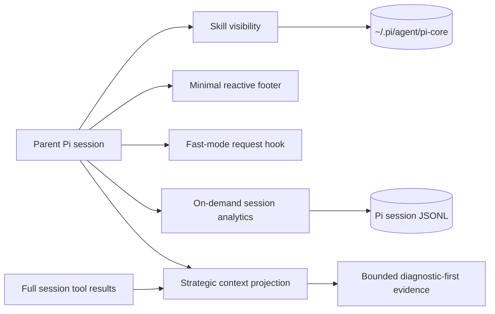

<p align="center">
  <h1 align="center">π Core</h1>
</p>

<p align="center">
  <strong>A lean control layer for the Pi coding agent.</strong>
</p>

<p align="center">
  <a href="https://github.com/enzodevs/pi-core/actions"></a>
  <a href="package.json"></a>
  <a href="LICENSE"></a>
</p>

<p align="center">
  <a href="#quickstart"><strong>Quickstart</strong></a> ·
  <a href="#browser-session-isolation"><strong>Browser sessions</strong></a> ·
  <a href="#context-inspector"><strong>Context</strong></a> ·
  <a href="#skill-visibility"><strong>Skills</strong></a> ·
  <a href="#session-analytics"><strong>Analytics</strong></a> ·
  <a href="#background-processes"><strong>Processes</strong></a> ·
  <a href="#ask-the-user"><strong>Questions</strong></a> ·
  <a href="#temporary-sudo"><strong>Sudo</strong></a> ·
  <a href="#minimal-footer"><strong>Footer</strong></a> ·
  <a href="#idle-recap"><strong>Recap</strong></a> ·
  <a href="#openai-fast-mode"><strong>Fast mode</strong></a> ·
  <a href="CONTEXT-HYGIENE.md"><strong>Context hygiene</strong></a>
</p>

**Pi Core** is a lean, Node-native control layer for [Pi](https://pi.dev): per-project skill visibility, durable memory, session analytics, background processes, focused TUI improvements, and an OpenAI Codex Fast mode toggle. It is designed around one constraint most agent tooling treats as an afterthought: **everything placed in context has a recurring cost**.

No polling loop. No sprawling always-active tool catalog. Variable output is bounded, and intermediate work stays outside the parent context.

## Why Pi Core

| Problem | Pi Core's answer |
| --- | --- |
| Every skill inflates every prompt | Choose `full`, `name`, `searchable`, or `off` per working directory |
| Old sessions are hard to inspect | Search transcripts and report cost, errors, models, and prompt patterns on demand |
| Fast mode requires restarting or hidden config | Toggle priority processing live with `/fast` |
| Context composition is opaque | Inspect prompt inputs and the last serialized provider payload with `/context` |
| Tool catalogs grow without discipline | Enforce a written context-hygiene policy for schemas and outputs |

## Highlights

- **Session-only local prompt translation** — opt-in PT-BR→English translation with `/translate on`, no extra agent context, and exact protection of common technical literals.
- **Model-invisible context inspector** — `/context` shows usage, prompt inputs, files, skills, tools, messages, and the last provider payload without creating a chat message or model-facing tool.
- **Exact-CWD skill profiles** — sessions in the same directory share one visibility policy.
- **Searchable skill catalog** — hide metadata from the prompt while retaining on-demand discovery.
- **Read-only session analytics** — inspect cost, transcripts, errors, and prompt patterns without an always-active tool.
- **Context hygiene** — bounded tool outputs and targeted retrieval without lossy rewriting of historical evidence.
- **Optional JSON compaction** — a local, lossless-only Headroom pilot, disabled by default, with exact original-file recovery.
- **Persistent Python kernel** — an opt-in `python` tool on Python 3.15 whose variables and helpers survive between calls and compaction, with bounded output.
- **Bounded background processes** — watch finite CI gates or run persistent services with rotating searchable logs and direct TUI control.
- **Deferred session scheduler** — persist one-shot, interval, and cron jobs; run shell checks without model calls and wake the agent only when needed. [Behavior and limits](extensions/scheduler/README.md).
- **Interactive questions** — ask for bounded free text, one choice, or multiple choices without guessing.
- **Temporary sudo** — approve each privileged command and enter a masked password that exists only in session memory.
- **Opt-in personal WhatsApp retrieval** — pair a read-only Baileys client only when requested and expose bounded message references and local audio transcripts.
- **Provider-scoped Fast mode** — injects `service_tier: "priority"` only for OAuth-backed `openai-codex` requests.
- **Responsive minimal footer** — model, thinking, branch, context, cost, and extension state without render-time I/O.
- **Ephemeral idle recap** — after three quiet minutes, show one tool-free sentence describing where the conversation stopped.
- **Automatic session titles** — name new sessions from their first completed exchange without touching conversation history.
- **Node-first TypeScript** — no Bun runtime APIs and no runtime framework beyond Pi's extension surface.

## Quickstart

### Requirements

- Node.js 22.19.0 or newer
- Pi 1.6.1 (the tested baseline; Pi peer dependencies use the 1.x compatibility range)
- A working Pi installation

See the [Pi 1.6.1 reconciliation](docs/pi-1.6.1.md) for the current compatibility review and decision-model guidance, the [Pi 1.6.0 reconciliation](docs/pi-1.6.0.md) for the previous baseline, and the [Pi 1.2.0 reconciliation](docs/pi-1.2.0.md) for remote clipboard limitations.

### Install from GitHub

```bash
pi install git:github.com/enzodevs/pi-core
```

Reload an existing Pi session after installation:

```text
/reload
```

For local development:

```bash
git clone https://github.com/enzodevs/pi-core.git
cd pi-core
npm install
pi install "$PWD"
```

Pi Core stores mutable state under `~/.pi/agent/pi-core/`. It never modifies discovered skill files.

## Personal WhatsApp retrieval

The optional WhatsApp extension is off by default. Run `/wpp on` to activate its single model tool and connect through the unofficial Baileys WhatsApp Web client. On first use, Pi writes a private QR PNG beneath `~/.pi/agent/pi-core/whatsapp/` and opens it with `xdg-open`; scan it from WhatsApp's **Linked devices** screen. `/wpp status` reports connection and index counts, while `/wpp off` disconnects and removes the tool from the active model surface. Pairing credentials remain local with owner-only permissions.

The tool is read-only and requires an explicit contact name, number fragment, or chat JID. Searches return at most 20 bounded records with opaque references, message direction, and quoted-reply metadata (original reference, author, kind and bounded text when supplied). Use the returned `next_before` as `before` to paginate without losing timestamp ties. `complete` describes only the local index, not the entire WhatsApp conversation. The `image` action accepts one retained image reference and returns the selected image (8 MiB maximum); old records without media descriptors require re-synchronization. Audio transcription accepts at most five prior references, deletes downloaded media after processing, and uses a local `whisper` executable when available. `whisper-cli` is also supported when `PI_WPP_WHISPER_MODEL_PATH` names a local model; `PI_WPP_WHISPER_MODEL` selects the Python Whisper model and defaults to `base`. A supported local transcription CLI must be installed before transcription can run.

The extension uses Baileys `7.0.0-rc14` inside a dedicated Node worker, loaded with the pinned `jiti` runtime. Detached dependency exceptions terminate only that worker: pending requests fail and Pi reports a disconnected WhatsApp session instead of exiting. `/wpp off` and `/wpp reset` terminate the worker after a bounded graceful stop, cancelling its remaining retry timers and credential writers before reset deletes any files. No process-wide exception handler is installed. After installing dependency or isolation changes, restart Pi completely before reconnecting (an already-loaded older client cannot be retroactively isolated).

The dependency requires Node 20+; Pi Core requires Node 22.19+.  Saved contact names and phone numbers are resolved through private persisted contact/LID mappings from history synchronization, contact updates, and v7 mapping events. Alternative phone identities attached to v7 messages are searchable too. Names or numbers not supplied by WhatsApp cannot be resolved.

The index retains the 1,000 newest messages **per chat JID**, with global ceilings of 50,000 records and 100 MiB. Ordering uses message timestamps, including when history arrives out of order. Busy chats no longer consume the entire 1,000-message budget. Replayed messages can enrich existing records with reply/media metadata. New messages are indexed while connected. Run `/wpp reset` to delete the local index and saved pairing credentials (without a backup) and start a fresh QR pairing. This does not delete conversations from your phone. After changing the extension, run `/reload` before using the new command.

After `/reload` and `/wpp on`, the model can use `action=history` with the selected contact to request up to 100 messages older than the oldest retained message, via Baileys `fetchMessageHistory`. This requires an unambiguous indexed chat. Delivery is asynchronous and depends on WhatsApp/the linked phone; request submission does not prove recovery. It sends a peer history request, not a chat message. Repeat only after inspecting received history. Retention limits still apply: a chat already holding 1,000 newer messages will discard older deliveries. Reload does not reconstruct discarded quote/media metadata; a fresh pairing may be needed for previously indexed messages.

WhatsApp controls linked-device history synchronization, so the local index contains only history delivered during pairing, on-demand history received, and messages observed while connected. Baileys is unofficial and may break when WhatsApp changes its private protocol; use a pinned version and understand the account/terms risk. Pi Core never sends chat messages through this integration.

## Context inspector

Run `/context` to open the dashboard, then use Tab and Shift+Tab to move through summary, files, skills, tools, messages, system-prompt, and provider-payload panels. Arrow keys select inventory rows or scroll raw content. The skills panel reports only `full` and `name` entries that are actually present in model context; searchable and off skills are explicitly excluded until their instructions enter the conversation through `load_skill`. The TUI is ephemeral: invoking it is handled before Pi creates a user message, registers no model-facing tool, writes no session entry, and sends no inspector output to the model.

The summary leads with an estimated next-request budget, split across the system prompt, messages, and active tool definitions. Before the first provider response, the footer shows this as `ctx ~N%` instead of the misleading measured `0%`; after a response it switches to Pi's provider-derived reading.

`payload` is the last serialized provider request observed by Pi Core and is the closest view to the exact wire body. The inspector is loaded last among Pi Core extensions, so it observes their earlier rewrites. A separately loaded extension ordered after it can still rewrite the payload; HTTP headers are not captured; and Pi may estimate current token usage between provider responses.

## Local prompt translation (opt-in)

`/translate on` locally translates PT-BR prompts to English before they enter the conversation; `/translate off` disables it and unloads the model. It starts off in new sessions and forks, while reload/resume preserves the same session's setting. Commands, status, translator instructions, and toggle metadata never enter agent context.

Run `make translate-install` to download the verified TranslateGemma 4B Q6 model (3.2 GB), then `make translate-test` to measure local latency and inspect sample translations. Requires a recent `llama-server` on PATH. Inference is offline, and code/common technical literals and images are preserved. Failures block submission and retain the original draft; `/translate recover` restores it locally. See [setup, preservation, and limitations](extensions/translate/README.md).

## Optional Headroom JSON pilot

From this source checkout, run `make headroom-install` (requires `uv` and Python), then `make headroom-test`. Reload Pi and use `/headroom-json on` to opt in for this Pi process; `/headroom-json off` disables it. It stays off by default and adds no model-facing tool.

Only large, complete JSON bash results with supported tabular shapes are compacted. Every rendered cell is checked, original JSON is saved privately with a recovery path, and failures leave results unchanged. File tools, failed commands, instructions, and historical messages are not rewritten. This optional Python worker does not add a Python requirement to the rest of Pi Core.

See [scope, storage, regression tests, and limitations](docs/headroom-json.md). RTK and ICM are not integrated.

## Persistent Python kernel (opt-in)

From this source checkout, run `make python-install` (requires `uv`). It installs Python 3.15 and a hash-locked kernel venv under `~/.pi/agent/pi-core/python/` (numpy, pandas, polars, duckdb, pyyaml, httpx). After a restart or `/reload`, Pi gets one `python` tool; without the runtime, the extension adds nothing.

The tool is **deferred**: its schema reaches the model only after `tool_search` loads it, so ordinary sessions do not pay for it. Enable `tool_search` with `"defaultTools": ["+tool_search"]` in settings. While `tool_search` is active and `python` is not loaded, the extension adds one line (a `<python_tool>` prompt section, kept even with a custom `SYSTEM.md`) telling the model the tool exists; without `tool_search` it adds nothing, and the tool stays callable from codemode scripts only.

- One persistent namespace per Pi session, run as a real `__main__` module (cell classes pickle): variables, imports and functions survive between calls and compaction (the model is told which names are still defined). `/python-reset` starts clean; a dead kernel is restarted on the next call with an explicit "state lost" note.
- The prelude uses Python 3.15 lazy imports, so `np`, `pd`, `pl`, `duckdb`, `Path`, `json`, … cost nothing until used (idle kernel ≈ 21 MB).
- The kernel follows the session directory set by `session-cwd`; an explicit `os.chdir()` holds until that directory changes, and an unavailable directory fails the cell instead of running elsewhere.
- `sh(cmd)` runs a shell command in the kernel's directory and returns `.code`/`.out`; beyond 4 MB it keeps the start and end with an omission marker (`.omitted` counts the dropped bytes). `pip(*pkgs)` installs into the **shared** kernel venv (visible to later sessions), with `uv --exclude-newer "7 days"` as a guard against freshly published malicious releases.
- Python and child-process output is captured in order. The model sees the start and end (~30 KB); longer output is kept under `~/.pi/agent/pi-core/python/outputs/` (pruned after 7 days or beyond 256 MB in total) and its path is named in the result. A cell whose output passes 64 MB while it runs is stopped like an interrupt, and exactly the first 64 MB are kept. Output that background processes write after their cell ended is read and discarded, so it never grows a file.
- Esc or the 10-minute cell limit kills the kernel and its process group (SIGSTOP, then SIGKILL, as Pi's `bash` tool does), and the next call starts a fresh kernel: **variables are lost**, and both that result and the next call say so. The host owns this, because in-process cancellation cannot reliably stop threads, event-loop callbacks or code that catches `KeyboardInterrupt`. Like with `bash`, processes that leave the group (`setsid`, daemons) are outside this boundary. Run servers and long jobs with `background_process`.
- Tracebacks show cell source within a 1 MB budget; older cells keep line numbers but lose their source lines, and a single larger cell is never kept.
- Threads started by a cell share the kernel's output: join them (or await tasks) before the cell ends, or their later output appears in a later cell.
- The kernel runs isolated (`python -I`): the working directory is not on `sys.path`, so project modules are not importable; run project code with the project's own environment through `sh()`.
- It is not a sandbox: code runs with your permissions, like `bash`.

`make python-install` re-syncs the venv to the lock (removing packages the model added with `pip()`); `npm run python:lock` refreshes the lock.

### Nested project guides (opt-in)

After reloading Pi, `/nested-agents on` enables bounded, read-triggered discovery of nested `AGENTS.md`/`CLAUDE.md` instructions within the startup project. It requires project trust and nonempty startup context, adds no tool or extra turn, and stays off by default. `/nested-agents off` disables it. See [scope, budgets, lifecycle policy, and verification limits](docs/nested-agents.md).

## Skill visibility

Pi Core controls how much information each skill contributes to model context. Settings layer from the global default, through global per-skill overrides, to project overrides. Git repositories use a stable project root (linked worktrees share the main checkout); outside Git, the exact working directory is used.

| Mode | Always-visible context | Searchable | Loadable |
| --- | --- | :---: | :---: |
| `full` | Name, description, and location | ✓ | ✓ |
| `name` | Name only | ✓ | ✓ |
| `searchable` | Nothing | ✓ | ✓ |
| `off` | Nothing | — | — |

Open the interactive manager:

```text
/skill-manager
```

Or update one skill directly. Project scope is the default; `inherit` removes an override:

```text
/skill-manager evidence-first-code-review searchable
/skill-manager evidence-first-code-review inherit
/skill-manager --global brave-ui-qa off
/skill-manager --global brave-ui-qa inherit
```

`/skill-manager` opens at project scope and `/skill-manager --global` opens at global scope. Inside either view, Tab or Shift+Tab switches between the project and global tabs. Press `/` to search names and descriptions using Pi's native input; Enter returns to navigation and Escape clears the search. Use Up/Down to navigate skills, Left/Right or Enter/Space to change modes, Home/End or Page Up/Page Down to jump, and Escape to close. The manager shows whether each effective value comes from the project, a global override, or the default, and adapts its detail and row count to the terminal size.

The model receives two compact tools for enabled skills:

- `search_skills` — search capability metadata without exposing the whole catalog.
- `load_skill` — load one exact skill when its full procedure is needed.

Profiles and the generated metadata index live at:

```text
~/.pi/agent/pi-core/skill-manager.json
~/.pi/agent/pi-core/skill-index.json
```

## Memory context

Pi Core integrates with the portable `agent-memory` CLI without adding an always-active model tool. On the first submitted prompt of a fresh session, it makes one retrieval attempt across project and global memory and injects at most two results above the calibrated `0.84` admission threshold as hidden, explicitly untrusted historical evidence. A non-context session entry records the attempt before I/O, including empty, failed or interrupted searches. Reload/resume does not retry it; forks with inherited attempts or user history retain their opening context instead of retrieving again. Legacy sessions with existing user history also skip a new opening lookup. A genuinely empty session remains eligible. The handoff is capped at 1.5 KiB, preserves complete paragraphs and source paths, removes duplicate titles/exact reaffirmations, and explicitly marks omitted evidence. Oversized paragraphs are omitted rather than clipped mid-qualification; use the source file to recover them. It persists in session context; later turns never repeat retrieval.

On genuine session shutdown (`quit`, `new`, `resume`, or `fork`), Pi Core only enqueues an append-only session checkpoint; extension reloads are ignored. Checkpoints record an immutable prefix hash and byte range, so later appends do not invalidate prior evidence and subsequent jobs process only the new suffix. A persistent systemd user timer runs daily around 03:15 and invokes one `openai-codex/gpt-5.6-terra` process at medium reasoning for up to eight pending jobs. Before Terra sees evidence, `agent-memory journal render` follows the active branch and emits at most 32 KiB of user text and assistant final text; thinking, tool calls/results, custom injections, malformed records, and previously processed prefixes are excluded. A private lock prevents concurrent consolidators, the run is capped at 15 minutes, and a dedicated system prompt requires all memory writes to pass through the validated CLI. Project and global candidates apply autonomously after deterministic validation, contradictions must use supersession, and automatic hard deletion is unavailable. Shutdown reconciliation terminalizes analyzed jobs whose candidates are already terminal. `agent-memory` remains responsible for Markdown truth, SQLite FTS/vector indexes, temporal metadata, candidates, provenance, stale-source checks, maintenance metrics, and atomic application.

Pi Core initializes an empty project root on first use; linked Git worktrees share the main checkout's root through `git-common-dir`, so parent and subagents see the same durable memory. If `agent-memory` is missing or retrieval fails, Pi continues without injected context. `/memory-status` shows bounded queue metrics; manual maintenance remains available through the portable agent-memory skill and CLI.

## Session analytics

The bundled `analyze-sessions` skill provides read-only, on-demand scripts over Pi's saved JSONL sessions. It can report cost by day, project, model, or session; search old user and assistant messages; render a session as Markdown; and extract prompts for recurring-pattern analysis. Subagent costs are included in cost totals by default, while transcript and prompt queries exclude child sessions unless requested.

The skill adds no always-active model-facing tool. Ask Pi questions such as “what did Pi cost this week?”, “find the session about rate limits”, or “show where recent sessions hit tool errors.”

## Context hygiene

Pi Core bounds output at tool boundaries; it does not rewrite historical tool results before model calls. The former rolling context guard and its artifact lookup tool have been removed: small retained-output budgets could erase useful evidence and cause recovery calls or repeated reads. Parent and child agents now retain the tool evidence provided by their tools, subject to Pi's normal output limits and compaction.

Use narrow paths, result limits, and source-side filters. For noisy checks, save full output, preserve the check's exit status, and inspect a focused summary. Read saved overflow output rather than rerunning a successful command. No output-compression CLI is injected automatically. See [CONTEXT-HYGIENE.md](CONTEXT-HYGIENE.md), [workflow and prompting guidance](docs/model-workflow.md), and the historical [RTK evaluation](docs/rtk-evaluation.md).

After upgrading, reload extensions or start a fresh Pi session to unload the old guard. Existing files under `~/.pi/agent/pi-core/context-artifacts/` are no longer read or written; they are left untouched rather than deleting historical session evidence.

## Delegation

Pi Core does not launch subagents. For explicitly requested delegation, use the global Herdr skill inside a Herdr pane. The child can end its turn with a plain-text question or result; wait for the turn to settle, then read it. Herdr does not forward the text to the parent. If upgrading from the native coordinator, finish any active children first and start a fresh Pi session. Existing sessions and worktrees are not deleted.

## Background processes

In the interactive TUI, `bash` commands that are still running after 10 seconds automatically hand off to the existing process manager. Fast commands retain Pi's normal output and exit status. A handoff returns `status: "running"` and `process_id`, with no `exit_code`; this also applies to `tools.bash()` in codemode, so await the process result before depending on its output. The command is never restarted, and its original timeout remains a cancellation deadline, not the handoff threshold. Search logs or cancel with `process_control`, `/ps`, or `/stop`; completion is steered to the next safe model boundary, or resumes the agent if it is idle. The finished tool call's abort signal no longer owns the process after handoff.

This integration uses the `session-cwd` bash wrapper and Pi's native shell backend, preserving the execution directory and session environment. Print, JSON and RPC modes remain synchronous; missing process support or a full process manager also keeps normal foreground execution. No tmux is required. Ending an interactive turn leaves the process running, but ending the session stops it.

The `background_process` tool runs any shell command asynchronously without spending a model-backed child. Its required mode makes the lifecycle contract explicit:

- `wait` expects a terminal result, making it suitable for CI gates, deployments, and provider-native watchers such as `gh run watch <id> --exit-status`.
- `service` expects to remain alive, making it suitable for development servers, application log streams, and similar session-owned processes. An unrequested service exit is a failure even when its exit code is zero.

```text
background_process(
  command="gh pr checks 123 --watch --fail-fast",
  mode="wait",
  cwd="/path/to/repo",
  timeoutSeconds=1800
)

background_process(
  command="npm run dev",
  mode="service",
  cwd="/path/to/repo"
)
```

Each process receives a short ID. Combined stdout/stderr is retained beneath `~/.pi/agent/pi-core/processes/` in two private rotating 4 MiB segments, so noisy services cannot grow storage without bound. Unread completions are coalesced into bounded batches and delivered through Pi's steering queue, after the current assistant turn's tools finish and before the next model call. An idle agent resumes automatically. Only one receipt is queued at a time; later batches can follow as soon as that receipt arrives, without waiting for the parent to settle. Each notification is at most 4 KiB, with a short excerpt per process; explicit `wait` reads retain the full bounded 4 KiB tail. Results already read through `wait` or a targeted terminal `status` are acknowledged persistently and are not replayed as new turns. A timed-out or cancelled wait, a running status, or a status listing does not consume a future completion. `process_control` keeps all model-facing inspection bounded:

| Action | Behavior |
| --- | --- |
| `status` | List recent processes, or inspect one process with its command and recent log tail; a terminal inspection acknowledges that result |
| `wait` | Await a result without polling; a completed read acknowledges it, including failures |
| `search` | Lexically search retained logs while a process is running or after it exits; returns at most 4 KiB of line-numbered context |
| `stop` | Terminate a running process and its process group |

Humans can use `/ps` (or `/ps <id>`) to open a live, keyboard-navigable process view with recent output; ↑/↓ selects a process and Esc closes it. The view refreshes once a second without adding its contents to model context. Use `/stop <id|all>` to terminate processes directly from the TUI. State is persisted before terminal delivery, and pending results recover after reload. Active attached process trees stop on branch changes, `/quit`, and other session shutdowns; `service` mode is not OS-level daemonization, and commands that deliberately detach themselves are outside its ownership boundary. No polling model or unbounded log transcript enters context.

## Ask the user

The `ask_user_question` tool pauses work for exactly one user decision. Omit `options` for free text, provide `options` for single select, or add `multiSelect: true` for multi-select. Choice prompts always include **Other** for a custom response. In print/JSON mode it returns a definitive unavailable result instead of hanging; RPC supports free-text prompts, while choice UIs require the interactive TUI. Questions, context, options, and returned text are bounded before entering model context.

```text
ask_user_question(
  question="Which release target should I use?",
  options=[{ label="Staging (Recommended)" }, { label="Production" }]
)
```

Concurrent popup calls share one UI lock and are shown serially.

## Temporary sudo

The `sudo` tool runs one shell command with root privileges. Every call displays the exact command for approval. On first use, Pi opens a masked password dialog; the password stays only in extension memory and is reused for approved commands in the current session. It is never placed in tool arguments, output, session history, environment variables, or process arguments.

Privileged output is capped at the last 2,000 lines or 50 KiB. Larger output is written to a private temporary file. `/sudo-lock` forgets the credential immediately; session shutdown also clears it and invalidates sudo's timestamp. The tool is unavailable outside Pi's interactive TUI.

## Minimal footer

Pi Core replaces the default footer with a restrained, single-line status surface:

```text
◇ gpt-5.6-terra · low · git:main │                    ctx 18% · $0.14 · ⚡ fast
```

It displays the active model and thinking level, a renamed session's title, Git branch, context usage, and extension statuses such as Fast mode. Unnamed sessions show no title or session ID. The layout progressively drops optional title and branch details on narrow terminals while retaining core state.

Rendering performs no filesystem, Git, network, or history scans. Git updates use Pi's footer watcher, cost is accumulated from message events, and width-safe Unicode characters avoid a Nerd Font dependency.

## Keyboard-first interface

Pi Core uses Pi's own theme and component runtime rather than starting another terminal renderer. Task-specific panels reserve their own headers, content viewports, and keyboard controls: resizing does not silently discard access to long commands, context, or descriptions. See [TUI architecture](docs/tui-ux.md) and [manual validation steps](docs/test-tui.md).

- **Ctrl+Shift+S** parks a text draft, restores it into an empty editor, or swaps it with another prompt without overwriting either. A compact indicator below the editor shows when a draft is parked; the prompt itself stays hidden. Attached-image prompts cannot be parked because attachments belong to the live editor. **Ctrl+Alt+D** opens a read-only, scrollable preview of the parked draft without changing the current prompt.
- **`@` autocomplete** prioritizes explicit directory prefixes, follows working-directory changes, and sanitizes filenames for display without changing inserted paths.
- **Clipboard images** show compact filenames and at most two small previews. **Ctrl+Alt+I** lists all attachments, previews the selected image, and offers confirmed detachment with `D`. `V` opens the full file path; originals are never deleted.
- **Questions** pin the prompt above the answers. Tab opens scrollable question/context/selected-description content. Escape returns without canceling; unfinished Other text survives going back. Multi-select supports Ctrl+Enter to submit.
- **Processes (`/ps`)** show recognizable commands, directories, state and recent output. Tab cycles overview → scrollable logs → full command/directory details. End resumes live logs. `S` offers an in-panel stop confirmation; Escape keeps the process running.
- **Skills** explain the selected mode and inheritance and acknowledge actual save success/failure. Failed writes retain the previous setting and can be retried.
- **Context (`/context`)** uses purpose-driven labels. Enter opens full inventory details; Escape returns to the selection. Tab still cycles panels.

The former Interstellar header, theme, and custom animation have been removed. Pi's native header and theme remain in control; working text stays visible, but the animated indicator is hidden. If you previously selected `interstellar`, select an available theme in `/settings`; Pi Core does not rewrite your personal settings.

These UI changes add no prompts, tool schemas, or conversation messages. Text draft state continues to use non-model custom session entries. Existing tools and recap retain their previous model behavior.

## Idle recap

After Pi settles and remains idle for three minutes, Pi Core generates one compact line of up to three terse phrases describing the task, progress, and immediate next step. It appears quietly below the editor and disappears when work resumes.

The recap prefers the authenticated `openai-codex/gpt-5.3-codex-spark` model at low reasoning and falls back to the active session model if Spark is unavailable or a Spark request fails. It exposes no tools and is never written to session history or added to model context. Stale or cancelled results are discarded. The timer also resets on terminal input while idle, so typing or moving the cursor postpones the recap. The listener never consumes input.

## Automatic session titles

After the first completed user-assistant exchange, an unnamed session receives a concise title for Pi's session selector. Existing and manually assigned names are never overwritten. Generation uses only bounded excerpts from that first exchange, prefers authenticated `openai-codex/gpt-5.3-codex-spark` at low reasoning, and falls back to the active model. Failures are silent, requests are cancelled on new input or session changes, and the generated title is metadata rather than conversation history.

## OpenAI Fast mode

Toggle faster processing for your ChatGPT subscription login without restarting the session:

```text
/fast               # toggle Fast (`service_tier: "priority"`)
/ultrafast          # toggle Ultrafast (`service_tier: "ultrafast"`)
/fast on            # also: /ultrafast on
/fast off           # also: /ultrafast off; both disable either mode
/fast status        # also: /ultrafast status
```

The modes are exclusive: enabling one replaces the other. They apply to the `openai` provider signed in with ChatGPT and to the legacy `openai-codex-responses` API; OpenAI API-key requests remain untouched because these tiers would bill them at premium rates.

Ultrafast needs a plan that includes it. The extension requests it for `gpt-6.2-astra`, `gpt-6.2-sol`, `gpt-6.1-sol`, and `gpt-6-astra`; other models use Fast, and the footer shows the tier in effect. Both modes consume plan usage faster, Ultrafast by far the most. The setting is shared by Pi sessions, including subagents, which read it when they start; an already-running process keeps the mode it loaded. The `service_tier` reported in responses can read `default` even when the requested tier is honored, so judge by speed rather than that field.

State persists at:

```text
~/.pi/agent/pi-core/fast-mode.json
```

Benchmark priority versus default processing with randomized, balanced runs:

```bash
npm run benchmark:fast -- --model gpt-5.3-codex --runs 10
```

The benchmark keeps one `pi --mode rpc` process—and its OpenAI Codex websocket—alive for the full run. It performs one excluded warmup, cycles three short prompts by default in fresh logical sessions, reports median and p95 time to first text and `agent_end`, saves raw events and summaries as JSON, and restores the original Fast mode JSON. Repeat `--prompt "..."` to supply custom prompts. Do not change `/fast` or run another benchmark concurrently; the setting is shared by all Pi processes.

## Context hygiene

[`CONTEXT-HYGIENE.md`](./CONTEXT-HYGIENE.md) is an engineering contract, not an aspirational note. It adapts agent-interface principles from [AXI](https://axi.md/) to Pi extensions:

- minimize always-on schemas;
- keep intermediate work outside model context;
- truncate variable output with explicit size hints;
- pre-compute useful aggregates;
- push completion instead of polling;
- use compact formats when measurement justifies them;
- return conclusions rather than transcripts.

## Architecture



## Subscription image generation

`generate_image` is deferred: discover it with `tool_search` when you need a PNG. It takes only a prompt and returns a path beneath `~/.pi/agent/pi-core/images/`, not image bytes. Use `read` on the path for a preview. Each call requests one image and uses subscription quota. Quality, size and background are automatic; describe any desired dimensions or transparency in the prompt and verify the PNG when exact output matters.

Requires a ChatGPT login from `codex login` in file credential storage (`$CODEX_HOME/auth.json`, normally `~/.codex/auth.json`). The Pi chat login alone is not sufficient. The tool uses only the access token and account ID, never refreshes or changes credentials, and never falls back to API billing. On HTTP 401 renew the CLI login. The Codex backend controls image quality and model availability; this is not the public Images API.

## Codemode (opt-in)

Pi 1.0 includes upstream codemode; pi-core does not implement a second sandbox. Enable it in `~/.pi/agent/settings.json` (merge with existing settings):

```json
{
  "defaultTools": ["+codemode"],
  "codemode": { "mode": "on" }
}
```

Preserve existing `defaultTools` entries when adding `+codemode`. Reload Pi or start a new session. Mode `on` keeps ordinary tools available; evaluate it before switching to `only`.

Scripts can batch independent calls and filter large results before printing a concise summary. Tool calls are real actions, not a transaction: a script failure does not undo earlier calls. The QuickJS sandbox has no Node, filesystem, or network APIs, but called tools retain their capabilities. Classifier and image-model calls use the session's provider credentials, may upload inputs to that provider, and may incur charges.

Pi-core compatibility boundaries:

- `ask_user_question` and `sudo` use `model-only` exposure: they stay directly available to the model but cannot be called from scripts. User interaction and privileged approval must not be hidden inside a batch.
- Session-CWD tools retain Pi's structured output schemas, so scripts receive structured bash results and honor session directory changes.
- The optional Headroom JSON pilot skips nested calls, preserving the raw structured values that scripts can filter themselves.
- Opt-in nested project guidance remains limited to direct reads. Codemode reads do not activate nested guides; explicitly read the applicable guide with a direct `read` when needed. Nested result metadata is not promoted into parent guidance.

`make test` includes local codemode integration tests against the real upstream QuickJS worker: batching/filtering, large structured output, mixed failures, nonzero exits, interactive-tool exclusion, nested-guide isolation, and session-CWD changes. These tests make no classifier, image-generation, or hosted chat requests.

## Moving a project

When renaming or moving a project directory, use the [project directory migration guide](docs/project-directory-migration.md) to preserve existing Pi session IDs and history. It includes a read-only dry run, migration checks, and an optional CC2 index-relocation procedure without rebuilding embeddings.

## Development

Development uses Node.js 24 LTS pinned in `.node-version`; both development and published extensions require Node.js 22.19.0 or newer, matching Pi 1.6.1. All four Pi development packages are pinned to the same version.

```bash
make install
make check
```

When Pi releases a new version, follow [PI-UPGRADES.md](PI-UPGRADES.md) for version detection, release review, dependency updates, and compatibility verification.

Run `make help` to list the focused development targets. The Makefile is a thin, stable interface over the package-owned npm scripts, so local development, CI, and coding agents use the same commands.

`make check` runs:

- Biome formatting and lint checks
- strict TypeScript compilation
- Vitest unit tests
- gating Fallow dead-code analysis

Run `make health` for advisory complexity and maintainability signals, or `make pack` to run required checks and inspect the package tarball contents. Both Fallow commands disable its cache and leave the working tree unchanged.

Compatibility checks cover two additional boundaries:

- The regular Vitest suite loads every configured extension through Pi's public extension loader and compiles an explicit public-API contract against the locked Pi dependencies.
- `make compat-package` packs pi-core, installs the tarball into an isolated temporary project with the locked Pi version, and loads every packaged extension.
- `make compat-latest` copies the repository to an isolated temporary directory, installs the latest published Pi packages, and runs type checking, tests, a package dry run, and `compat:package`. The final check installs the tarball and loads its extensions, catching incompatible peer dependency ranges as well as loader failures. It is intentionally opt-in because it requires network access and may expose an upstream breaking change before pi-core updates its lockfile.

Set `PI_CORE_KEEP_COMPAT_TEMP=1` to preserve a compatibility command's temporary workspace for diagnosis.

Runtime source is loaded directly by Pi's TypeScript loader. Package releases include only extensions, documentation, and the license.

## License

[MIT](LICENSE) © Enzo Cambraia
